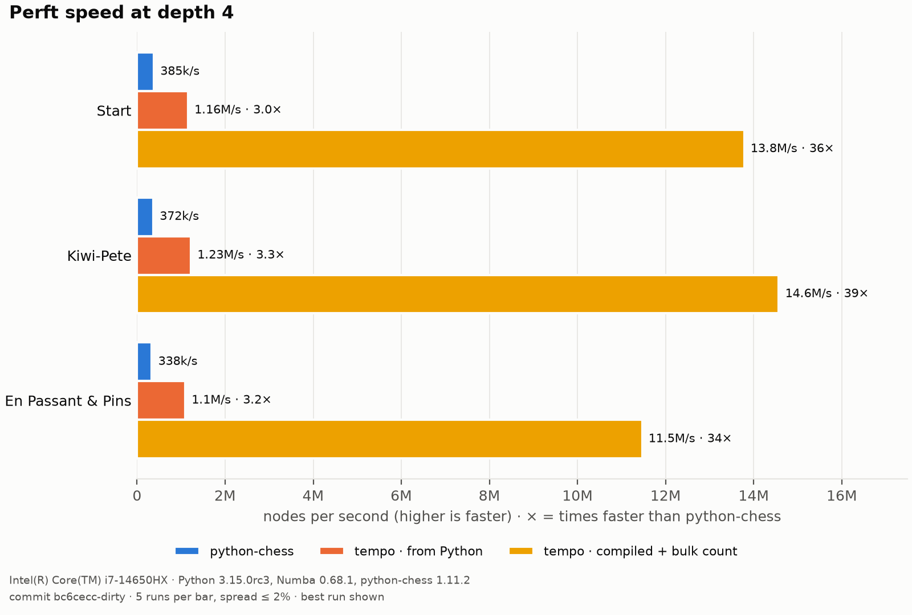
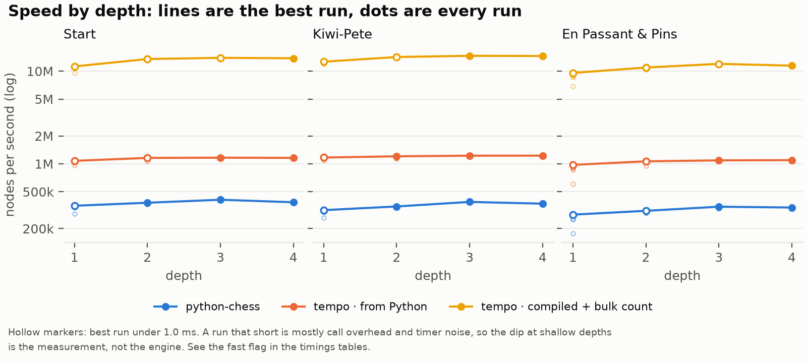
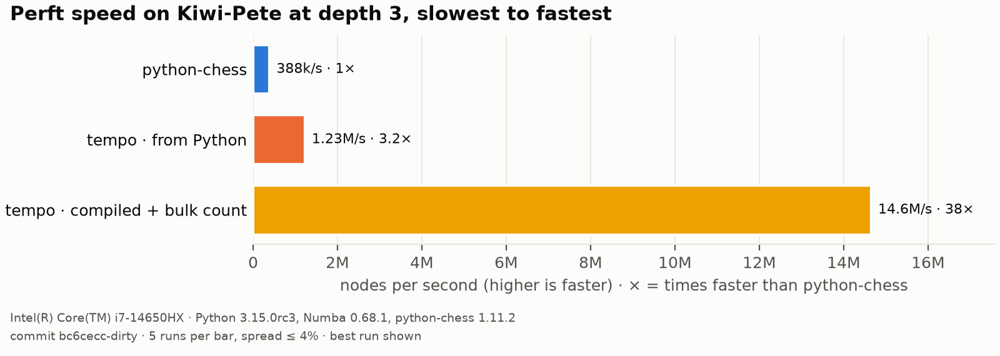

# Perft benchmark: `bc6cecc-dirty`, 2026-11-10

At depth 4, measured against python-chess on the same positions: **tempo · from Python** 3.0–3.3× and **tempo · compiled + bulk count** 34–39× (best run against best run; above 1× is faster).

| Position | Nodes | python-chess | tempo · from Python | tempo · compiled + bulk count |
|---|---:|---:|---:|---:|
| Start | 197,281 | 512.1 ms · 385.23k/s | 170.1 ms · 1.16M/s (3.0×) | 14.3 ms · 13.78M/s (36×) |
| Kiwi-Pete | 4,085,603 | 10.99 s · 371.87k/s | 3.33 s · 1.23M/s (3.3×) | 280.4 ms · 14.57M/s (39×) |
| En Passant & Pins | 43,238 | 128.0 ms · 337.77k/s | 39.4 ms · 1.10M/s (3.2×) | 3.8 ms · 11.47M/s (34×) |

## Correctness

Node counts from every run, checked against the published perft results on the [Chess Programming Wiki](https://www.chessprogramming.org/Perft_Results), which are independent of python-chess. A ✓ needs all runs of that engine to agree with it.

| Position | Depth | Published | python-chess | tempo · from Python | tempo · compiled + bulk count |
|---|---:|---:|---:|---:|---:|
| Start | 1 | 20 | 20 ✓ | 20 ✓ | 20 ✓ |
| Start | 2 | 400 | 400 ✓ | 400 ✓ | 400 ✓ |
| Start | 3 | 8,902 | 8,902 ✓ | 8,902 ✓ | 8,902 ✓ |
| Start | 4 | 197,281 | 197,281 ✓ | 197,281 ✓ | 197,281 ✓ |
| Kiwi-Pete | 1 | 48 | 48 ✓ | 48 ✓ | 48 ✓ |
| Kiwi-Pete | 2 | 2,039 | 2,039 ✓ | 2,039 ✓ | 2,039 ✓ |
| Kiwi-Pete | 3 | 97,862 | 97,862 ✓ | 97,862 ✓ | 97,862 ✓ |
| Kiwi-Pete | 4 | 4,085,603 | 4,085,603 ✓ | 4,085,603 ✓ | 4,085,603 ✓ |
| En Passant & Pins | 1 | 14 | 14 ✓ | 14 ✓ | 14 ✓ |
| En Passant & Pins | 2 | 191 | 191 ✓ | 191 ✓ | 191 ✓ |
| En Passant & Pins | 3 | 2,812 | 2,812 ✓ | 2,812 ✓ | 2,812 ✓ |
| En Passant & Pins | 4 | 43,238 | 43,238 ✓ | 43,238 ✓ | 43,238 ✓ |

Every run of every engine matches the published count.

## Engines
- **python-chess**: The course harness's reference_perft: chess.Board driven from Python, one push/pop per node.
- **tempo · from Python**: The course harness's custom_perft on b.Board, also driven from Python once per node. Mostly measures per-node interface cost, not move generation.
- **tempo · compiled + bulk count**: movegen.perft: the whole recursion in Numba, no Python per node. What the board itself can do. Leaves are counted from the legal-move list instead of pushed one by one.

## All timings

Best, median and slowest of 5 runs per cell. Spread is (slowest − best) / best. Nodes/s and speedup use the best run. Flags: **fast** = best run under 1.0 ms, so call overhead and timer noise dominate; **noisy** = spread above 10%. Raw run times are under each table and in [results.json](results.json).

### Start

`rnbqkbnr/pppppppp/8/8/8/8/PPPPPPPP/RNBQKBNR w KQkq - 0 1`

| Depth | Nodes | Engine | Best | Median | Slowest | Spread | Nodes/s | vs python-chess | Flags |
|---:|---:|---|---:|---:|---:|---:|---:|---:|---|
| 1 | 20 | python-chess | 57 µs | 58 µs | 69 µs | 22% | 352.86k/s | — | fast, noisy |
| 1 | 20 | tempo · from Python | 19 µs | 19 µs | 21 µs | 12% | 1.08M/s | 3.1× | fast, noisy |
| 1 | 20 | tempo · compiled + bulk count | 2 µs | 2 µs | 2 µs | 18% | 11.25M/s | 32× | fast, noisy |
| 2 | 400 | python-chess | 1.1 ms | 1.1 ms | 1.1 ms | 4% | 380.53k/s | — |  |
| 2 | 400 | tempo · from Python | 345 µs | 352 µs | 374 µs | 8% | 1.16M/s | 3.0× | fast |
| 2 | 400 | tempo · compiled + bulk count | 30 µs | 30 µs | 30 µs | 2% | 13.52M/s | 36× | fast |
| 3 | 8,902 | python-chess | 21.7 ms | 21.8 ms | 22.2 ms | 2% | 409.84k/s | — |  |
| 3 | 8,902 | tempo · from Python | 7.6 ms | 7.7 ms | 7.7 ms | 1% | 1.17M/s | 2.8× |  |
| 3 | 8,902 | tempo · compiled + bulk count | 639 µs | 649 µs | 669 µs | 5% | 13.93M/s | 34× | fast |
| 4 | 197,281 | python-chess | 512.1 ms | 517.8 ms | 520.6 ms | 2% | 385.23k/s | — |  |
| 4 | 197,281 | tempo · from Python | 170.1 ms | 170.4 ms | 170.8 ms | 0% | 1.16M/s | 3.0× |  |
| 4 | 197,281 | tempo · compiled + bulk count | 14.3 ms | 14.4 ms | 14.4 ms | 1% | 13.78M/s | 36× |  |

Raw run times, in run order

| Depth | Engine | Runs (ms) |
|---:|---|---|
| 1 | python-chess | 0.06927, 0.05949, 0.05786, 0.0577, 0.05668 |
| 1 | tempo · from Python | 0.02084, 0.01916, 0.01892, 0.01897, 0.01856 |
| 1 | tempo · compiled + bulk count | 0.002088, 0.001807, 0.001848, 0.001777, 0.00183 |
| 2 | python-chess | 1.089, 1.089, 1.075, 1.051, 1.065 |
| 2 | tempo · from Python | 0.3517, 0.3465, 0.3521, 0.3451, 0.3739 |
| 2 | tempo · compiled + bulk count | 0.03018, 0.02963, 0.02959, 0.0296, 0.02965 |
| 3 | python-chess | 21.75, 21.72, 22.22, 21.8, 21.79 |
| 3 | tempo · from Python | 7.639, 7.683, 7.702, 7.689, 7.654 |
| 3 | tempo · compiled + bulk count | 0.6391, 0.6494, 0.6693, 0.6503, 0.6481 |
| 4 | python-chess | 512.1, 520.6, 518.6, 517.8, 514.8 |
| 4 | tempo · from Python | 170.2, 170.8, 170.6, 170.1, 170.4 |
| 4 | tempo · compiled + bulk count | 14.31, 14.39, 14.43, 14.36, 14.37 |

### Kiwi-Pete

`r3k2r/p1ppqpb1/bn2pnp1/3PN3/1p2P3/2N2Q1p/PPPBBPPP/R3K2R w KQkq - 0 1`

| Depth | Nodes | Engine | Best | Median | Slowest | Spread | Nodes/s | vs python-chess | Flags |
|---:|---:|---|---:|---:|---:|---:|---:|---:|---|
| 1 | 48 | python-chess | 152 µs | 156 µs | 183 µs | 21% | 316.54k/s | — | fast, noisy |
| 1 | 48 | tempo · from Python | 41 µs | 42 µs | 44 µs | 8% | 1.17M/s | 3.7× | fast |
| 1 | 48 | tempo · compiled + bulk count | 4 µs | 4 µs | 4 µs | 5% | 12.64M/s | 40× | fast |
| 2 | 2,039 | python-chess | 5.9 ms | 5.9 ms | 6.0 ms | 2% | 346.90k/s | — |  |
| 2 | 2,039 | tempo · from Python | 1.7 ms | 1.7 ms | 1.8 ms | 7% | 1.21M/s | 3.5× |  |
| 2 | 2,039 | tempo · compiled + bulk count | 143 µs | 144 µs | 147 µs | 3% | 14.21M/s | 41× | fast |
| 3 | 97,862 | python-chess | 251.9 ms | 252.1 ms | 253.6 ms | 1% | 388.46k/s | — |  |
| 3 | 97,862 | tempo · from Python | 79.9 ms | 80.0 ms | 80.2 ms | 0% | 1.23M/s | 3.2× |  |
| 3 | 97,862 | tempo · compiled + bulk count | 6.7 ms | 6.8 ms | 6.9 ms | 3% | 14.65M/s | 38× |  |
| 4 | 4,085,603 | python-chess | 10.99 s | 10.99 s | 11.03 s | 0% | 371.87k/s | — |  |
| 4 | 4,085,603 | tempo · from Python | 3.33 s | 3.33 s | 3.34 s | 0% | 1.23M/s | 3.3× |  |
| 4 | 4,085,603 | tempo · compiled + bulk count | 280.4 ms | 281.2 ms | 281.8 ms | 1% | 14.57M/s | 39× |  |

Raw run times, in run order

| Depth | Engine | Runs (ms) |
|---:|---|---|
| 1 | python-chess | 0.1835, 0.1598, 0.156, 0.1559, 0.1516 |
| 1 | tempo · from Python | 0.04415, 0.04103, 0.04198, 0.04258, 0.04224 |
| 1 | tempo · compiled + bulk count | 0.004, 0.003845, 0.003796, 0.003974, 0.003854 |
| 2 | python-chess | 5.953, 6.016, 5.88, 5.878, 5.929 |
| 2 | tempo · from Python | 1.803, 1.759, 1.691, 1.7, 1.725 |
| 2 | tempo · compiled + bulk count | 0.1454, 0.1439, 0.1441, 0.1434, 0.1473 |
| 3 | python-chess | 253.6, 253, 252.1, 252, 251.9 |
| 3 | tempo · from Python | 80.13, 80.04, 80.01, 80.23, 79.87 |
| 3 | tempo · compiled + bulk count | 6.907, 6.729, 6.68, 6.776, 6.756 |
| 4 | python-chess | 1.103e+04, 1.099e+04, 1.1e+04, 1.099e+04, 1.099e+04 |
| 4 | tempo · from Python | 3338, 3338, 3334, 3334, 3331 |
| 4 | tempo · compiled + bulk count | 281.8, 281.3, 281.2, 280.6, 280.4 |

### En Passant & Pins

`8/2p5/3p4/KP5r/1R3p1k/8/4P1P1/8 w - - 0 1`

| Depth | Nodes | Engine | Best | Median | Slowest | Spread | Nodes/s | vs python-chess | Flags |
|---:|---:|---|---:|---:|---:|---:|---:|---:|---|
| 1 | 14 | python-chess | 49 µs | 55 µs | 79 µs | 60% | 283.09k/s | — | fast, noisy |
| 1 | 14 | tempo · from Python | 14 µs | 15 µs | 23 µs | 62% | 975.20k/s | 3.4× | fast, noisy |
| 1 | 14 | tempo · compiled + bulk count | 1 µs | 2 µs | 2 µs | 39% | 9.58M/s | 34× | fast, noisy |
| 2 | 191 | python-chess | 614 µs | 636 µs | 653 µs | 6% | 311.29k/s | — | fast |
| 2 | 191 | tempo · from Python | 179 µs | 182 µs | 202 µs | 12% | 1.06M/s | 3.4× | fast, noisy |
| 2 | 191 | tempo · compiled + bulk count | 17 µs | 18 µs | 18 µs | 6% | 10.94M/s | 35× | fast |
| 3 | 2,812 | python-chess | 8.2 ms | 8.3 ms | 8.6 ms | 5% | 344.82k/s | — |  |
| 3 | 2,812 | tempo · from Python | 2.6 ms | 2.6 ms | 2.6 ms | 2% | 1.09M/s | 3.2× |  |
| 3 | 2,812 | tempo · compiled + bulk count | 234 µs | 235 µs | 241 µs | 3% | 12.00M/s | 35× | fast |
| 4 | 43,238 | python-chess | 128.0 ms | 128.1 ms | 128.3 ms | 0% | 337.77k/s | — |  |
| 4 | 43,238 | tempo · from Python | 39.4 ms | 39.5 ms | 39.6 ms | 0% | 1.10M/s | 3.2× |  |
| 4 | 43,238 | tempo · compiled + bulk count | 3.8 ms | 3.8 ms | 3.8 ms | 1% | 11.47M/s | 34× |  |

Raw run times, in run order

| Depth | Engine | Runs (ms) |
|---:|---|---|
| 1 | python-chess | 0.07901, 0.0554, 0.05456, 0.04965, 0.04946 |
| 1 | tempo · from Python | 0.0232, 0.01547, 0.01635, 0.01543, 0.01436 |
| 1 | tempo · compiled + bulk count | 0.002032, 0.001582, 0.001628, 0.001542, 0.001462 |
| 2 | python-chess | 0.6355, 0.6136, 0.6162, 0.6373, 0.6531 |
| 2 | tempo · from Python | 0.1823, 0.1811, 0.1822, 0.2015, 0.1794 |
| 2 | tempo · compiled + bulk count | 0.01777, 0.01792, 0.01774, 0.01846, 0.01746 |
| 3 | python-chess | 8.155, 8.206, 8.587, 8.262, 8.261 |
| 3 | tempo · from Python | 2.596, 2.627, 2.58, 2.59, 2.58 |
| 3 | tempo · compiled + bulk count | 0.2413, 0.2345, 0.2344, 0.2347, 0.2371 |
| 4 | python-chess | 128.3, 128.1, 128, 128.1, 128 |
| 4 | tempo · from Python | 39.6, 39.44, 39.55, 39.51, 39.48 |
| 4 | tempo · compiled + bulk count | 3.775, 3.773, 3.771, 3.786, 3.79 |

## Warm-up (not counted)

One run per engine and position at depth 2 before any measurement, recorded here and left out of every other number. For tempo the first one includes Numba compiling or loading its cache, which is why it is much slower than the rest.

| Position | python-chess | tempo · from Python | tempo · compiled + bulk count |
|---|---:|---:|---:|
| Start | 1.3 ms | 9.3 ms | 4.4 ms |
| Kiwi-Pete | 8.5 ms | 1.7 ms | 142 µs |
| En Passant & Pins | 661 µs | 183 µs | 18 µs |

## Run
- **Commit:** `bc6cecc` (uncommitted changes present: numbers may not match this commit exactly)
- **When:** 2026-11-10T12:08:15 to 2026-11-10T12:09:35
- **Machine:** Intel(R) Core(TM) i7-14650HX, 24 threads, Linux-7.0.0-43-generic-x86_64-with-glibc2.43
- **Load average:** [0.71, 0.49, 0.5] at start, [0.93, 0.62, 0.55] at end (1, 5, 15 min)
- **Versions:** Python 3.15.0rc3, python-chess 1.11.2, numba 0.68.1, JIT on
- **Settings:** depths 1–4, 5 timed runs per engine per cell, warm-up at depth 2, GC off while timing, time.perf_counter (resolution 1e-09 s)

## Method
- Each engine's position object is built once per cell, outside the timer. Perft pushes and pops back to the root, so later runs start from the same position.
- Within a cell, engines take turns run by run (A, B, C, A, B, C, ...), so slow drift such as thermal throttling or background load hits every engine alike instead of one engine's whole batch.
- The garbage collector is off while timing, as in `timeit`.
- Best run is the headline number because noise only ever adds time; median and slowest are shown so you can see how much noise there was.
- Everything on this page is generated from `results.json` by `bench/report.py`; no number is typed by hand.

_Regenerate with `python -m ccc26.user.eradcliffe.bench.report 2026-11-10_120815_bc6cecc-dirty`._
