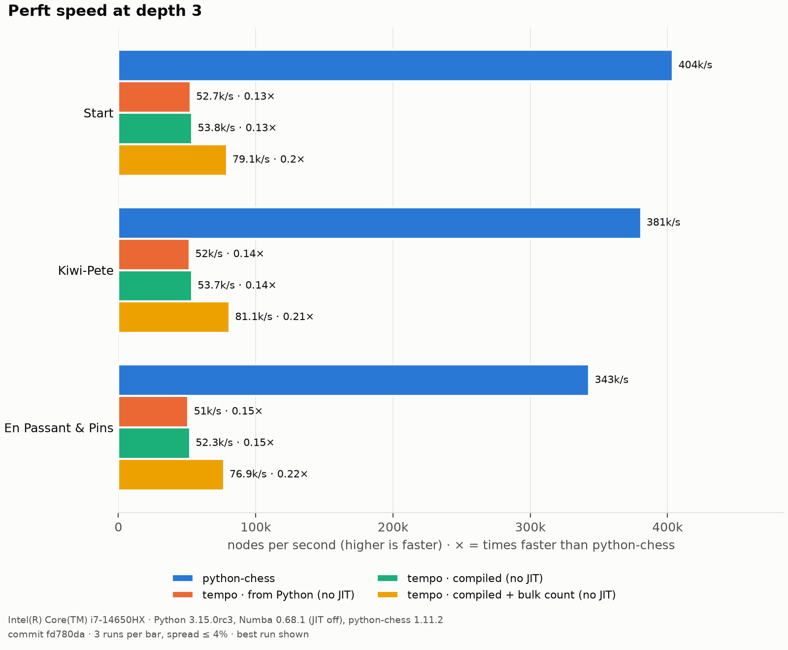
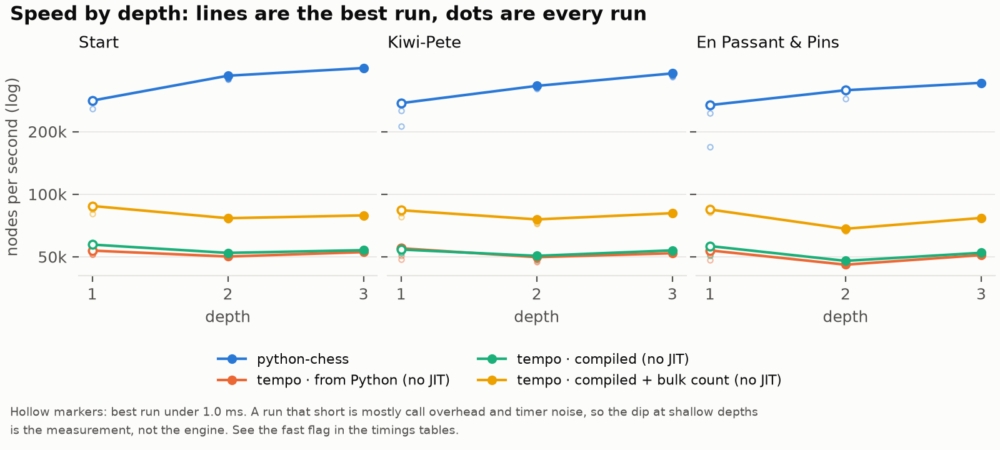
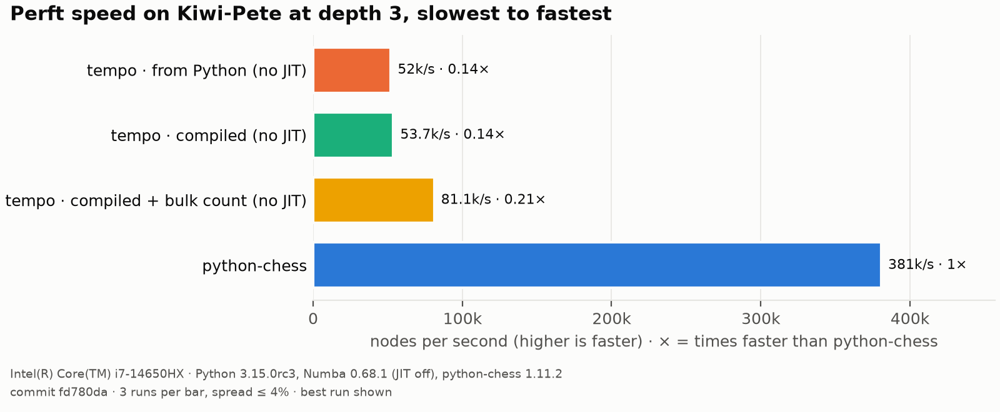

# Perft benchmark: `fd780da`, 2026-11-10

At depth 3, measured against python-chess on the same positions: **tempo · from Python (no JIT)** 0.13–0.15×, **tempo · compiled (no JIT)** 0.13–0.15× and **tempo · compiled + bulk count (no JIT)** 0.2–0.22× (best run against best run; above 1× is faster).

| Position | Nodes | python-chess | tempo · from Python (no JIT) | tempo · compiled (no JIT) | tempo · compiled + bulk count (no JIT) |
|---|---:|---:|---:|---:|---:|
| Start | 8,902 | 22.0 ms · 404.02k/s | 169.0 ms · 52.68k/s (0.13×) | 165.4 ms · 53.83k/s (0.13×) | 112.6 ms · 79.08k/s (0.2×) |
| Kiwi-Pete | 97,862 | 257.0 ms · 380.76k/s | 1.88 s · 52.01k/s (0.14×) | 1.82 s · 53.71k/s (0.14×) | 1.21 s · 81.05k/s (0.21×) |
| En Passant & Pins | 2,812 | 8.2 ms · 343.00k/s | 55.2 ms · 50.97k/s (0.15×) | 53.8 ms · 52.28k/s (0.15×) | 36.6 ms · 76.89k/s (0.22×) |

## Correctness

Node counts from every run, checked against the published perft results on the [Chess Programming Wiki](https://www.chessprogramming.org/Perft_Results), which are independent of python-chess. A ✓ needs all runs of that engine to agree with it.

| Position | Depth | Published | python-chess | tempo · from Python (no JIT) | tempo · compiled (no JIT) | tempo · compiled + bulk count (no JIT) |
|---|---:|---:|---:|---:|---:|---:|
| Start | 1 | 20 | 20 ✓ | 20 ✓ | 20 ✓ | 20 ✓ |
| Start | 2 | 400 | 400 ✓ | 400 ✓ | 400 ✓ | 400 ✓ |
| Start | 3 | 8,902 | 8,902 ✓ | 8,902 ✓ | 8,902 ✓ | 8,902 ✓ |
| Kiwi-Pete | 1 | 48 | 48 ✓ | 48 ✓ | 48 ✓ | 48 ✓ |
| Kiwi-Pete | 2 | 2,039 | 2,039 ✓ | 2,039 ✓ | 2,039 ✓ | 2,039 ✓ |
| Kiwi-Pete | 3 | 97,862 | 97,862 ✓ | 97,862 ✓ | 97,862 ✓ | 97,862 ✓ |
| En Passant & Pins | 1 | 14 | 14 ✓ | 14 ✓ | 14 ✓ | 14 ✓ |
| En Passant & Pins | 2 | 191 | 191 ✓ | 191 ✓ | 191 ✓ | 191 ✓ |
| En Passant & Pins | 3 | 2,812 | 2,812 ✓ | 2,812 ✓ | 2,812 ✓ | 2,812 ✓ |

Every run of every engine matches the published count.

## Engines
- **python-chess**: The course harness's reference_perft: chess.Board driven from Python, one push/pop per node, every leaf played.
- **tempo · from Python (no JIT)**: The course harness's custom_perft on b.Board, also driven from Python once per node with every leaf played. Mostly measures per-node interface cost, not move generation.
- **tempo · compiled (no JIT)**: movegen.perft_every_leaf: the whole recursion in Numba, no Python per node, every leaf move made. What the board itself can do, on the same terms as the two above.
- **tempo · compiled + bulk count (no JIT)**: movegen.perft: like tempo · compiled, but the last ply is counted from the legal-move list instead of making each leaf move (bulk counting). Same nodes, less work per node.

## All timings

Best, median and slowest of 3 runs per cell. Spread is (slowest − best) / best. Nodes/s and speedup use the best run. Flags: **fast** = best run under 1.0 ms, so call overhead and timer noise dominate; **noisy** = spread above 10%. Raw run times are under each table and in [results.json](results.json).

### Start

`rnbqkbnr/pppppppp/8/8/8/8/PPPPPPPP/RNBQKBNR w KQkq - 0 1`

| Depth | Nodes | Engine | Best | Median | Slowest | Spread | Nodes/s | vs python-chess | Flags |
|---:|---:|---|---:|---:|---:|---:|---:|---:|---|
| 1 | 20 | python-chess | 71 µs | 72 µs | 78 µs | 10% | 281.83k/s | — | fast |
| 1 | 20 | tempo · from Python (no JIT) | 373 µs | 389 µs | 390 µs | 5% | 53.57k/s | 0.19× | fast |
| 1 | 20 | tempo · compiled (no JIT) | 349 µs | 353 µs | 353 µs | 1% | 57.24k/s | 0.2× | fast |
| 1 | 20 | tempo · compiled + bulk count (no JIT) | 228 µs | 237 µs | 249 µs | 9% | 87.78k/s | 0.31× | fast |
| 2 | 400 | python-chess | 1.1 ms | 1.1 ms | 1.1 ms | 4% | 371.09k/s | — |  |
| 2 | 400 | tempo · from Python (no JIT) | 8.0 ms | 8.0 ms | 8.0 ms | 0% | 50.16k/s | 0.14× |  |
| 2 | 400 | tempo · compiled (no JIT) | 7.7 ms | 7.8 ms | 7.8 ms | 2% | 52.23k/s | 0.14× |  |
| 2 | 400 | tempo · compiled + bulk count (no JIT) | 5.2 ms | 5.3 ms | 5.3 ms | 2% | 76.66k/s | 0.21× |  |
| 3 | 8,902 | python-chess | 22.0 ms | 22.1 ms | 22.3 ms | 1% | 404.02k/s | — |  |
| 3 | 8,902 | tempo · from Python (no JIT) | 169.0 ms | 169.1 ms | 170.6 ms | 1% | 52.68k/s | 0.13× |  |
| 3 | 8,902 | tempo · compiled (no JIT) | 165.4 ms | 165.5 ms | 167.3 ms | 1% | 53.83k/s | 0.13× |  |
| 3 | 8,902 | tempo · compiled + bulk count (no JIT) | 112.6 ms | 112.9 ms | 114.8 ms | 2% | 79.08k/s | 0.2× |  |

Raw run times, in run order

| Depth | Engine | Runs (ms) |
|---:|---|---|
| 1 | python-chess | 0.07789, 0.07171, 0.07096 |
| 1 | tempo · from Python (no JIT) | 0.3734, 0.3903, 0.3893 |
| 1 | tempo · compiled (no JIT) | 0.3532, 0.3494, 0.3526 |
| 1 | tempo · compiled + bulk count (no JIT) | 0.2491, 0.2371, 0.2279 |
| 2 | python-chess | 1.122, 1.112, 1.078 |
| 2 | tempo · from Python (no JIT) | 7.974, 8.012, 7.975 |
| 2 | tempo · compiled (no JIT) | 7.834, 7.758, 7.659 |
| 2 | tempo · compiled + bulk count (no JIT) | 5.314, 5.284, 5.218 |
| 3 | python-chess | 22.03, 22.09, 22.34 |
| 3 | tempo · from Python (no JIT) | 169, 169.1, 170.6 |
| 3 | tempo · compiled (no JIT) | 165.4, 165.5, 167.3 |
| 3 | tempo · compiled + bulk count (no JIT) | 112.6, 112.9, 114.8 |

### Kiwi-Pete

`r3k2r/p1ppqpb1/bn2pnp1/3PN3/1p2P3/2N2Q1p/PPPBBPPP/R3K2R w KQkq - 0 1`

| Depth | Nodes | Engine | Best | Median | Slowest | Spread | Nodes/s | vs python-chess | Flags |
|---:|---:|---|---:|---:|---:|---:|---:|---:|---|
| 1 | 48 | python-chess | 175 µs | 190 µs | 227 µs | 30% | 273.92k/s | — | fast, noisy |
| 1 | 48 | tempo · from Python (no JIT) | 873 µs | 948 µs | 989 µs | 13% | 54.96k/s | 0.2× | fast, noisy |
| 1 | 48 | tempo · compiled (no JIT) | 886 µs | 914 µs | 921 µs | 4% | 54.20k/s | 0.2× | fast |
| 1 | 48 | tempo · compiled + bulk count (no JIT) | 573 µs | 592 µs | 616 µs | 7% | 83.73k/s | 0.31× | fast |
| 2 | 2,039 | python-chess | 6.1 ms | 6.2 ms | 6.3 ms | 3% | 331.61k/s | — |  |
| 2 | 2,039 | tempo · from Python (no JIT) | 40.9 ms | 41.8 ms | 43.1 ms | 5% | 49.81k/s | 0.15× |  |
| 2 | 2,039 | tempo · compiled (no JIT) | 40.3 ms | 40.5 ms | 42.0 ms | 4% | 50.54k/s | 0.15× |  |
| 2 | 2,039 | tempo · compiled + bulk count (no JIT) | 26.9 ms | 27.3 ms | 28.2 ms | 5% | 75.66k/s | 0.23× |  |
| 3 | 97,862 | python-chess | 257.0 ms | 263.6 ms | 266.5 ms | 4% | 380.76k/s | — |  |
| 3 | 97,862 | tempo · from Python (no JIT) | 1.88 s | 1.89 s | 1.89 s | 0% | 52.01k/s | 0.14× |  |
| 3 | 97,862 | tempo · compiled (no JIT) | 1.82 s | 1.82 s | 1.86 s | 2% | 53.71k/s | 0.14× |  |
| 3 | 97,862 | tempo · compiled + bulk count (no JIT) | 1.21 s | 1.22 s | 1.22 s | 1% | 81.05k/s | 0.21× |  |

Raw run times, in run order

| Depth | Engine | Runs (ms) |
|---:|---|---|
| 1 | python-chess | 0.227, 0.1902, 0.1752 |
| 1 | tempo · from Python (no JIT) | 0.9885, 0.8733, 0.9477 |
| 1 | tempo · compiled (no JIT) | 0.9212, 0.9145, 0.8856 |
| 1 | tempo · compiled + bulk count (no JIT) | 0.5917, 0.6157, 0.5733 |
| 2 | python-chess | 6.326, 6.181, 6.149 |
| 2 | tempo · from Python (no JIT) | 43.09, 40.94, 41.82 |
| 2 | tempo · compiled (no JIT) | 42.05, 40.35, 40.49 |
| 2 | tempo · compiled + bulk count (no JIT) | 28.18, 27.3, 26.95 |
| 3 | python-chess | 263.6, 266.5, 257 |
| 3 | tempo · from Python (no JIT) | 1882, 1888, 1887 |
| 3 | tempo · compiled (no JIT) | 1825, 1857, 1822 |
| 3 | tempo · compiled + bulk count (no JIT) | 1220, 1207, 1220 |

### En Passant & Pins

`8/2p5/3p4/KP5r/1R3p1k/8/4P1P1/8 w - - 0 1`

| Depth | Nodes | Engine | Best | Median | Slowest | Spread | Nodes/s | vs python-chess | Flags |
|---:|---:|---|---:|---:|---:|---:|---:|---:|---|
| 1 | 14 | python-chess | 52 µs | 57 µs | 83 µs | 59% | 268.15k/s | — | fast, noisy |
| 1 | 14 | tempo · from Python (no JIT) | 261 µs | 273 µs | 289 µs | 11% | 53.68k/s | 0.2× | fast, noisy |
| 1 | 14 | tempo · compiled (no JIT) | 249 µs | 255 µs | 277 µs | 11% | 56.32k/s | 0.21× | fast, noisy |
| 1 | 14 | tempo · compiled + bulk count (no JIT) | 166 µs | 166 µs | 172 µs | 4% | 84.44k/s | 0.31× | fast |
| 2 | 191 | python-chess | 604 µs | 615 µs | 665 µs | 10% | 316.08k/s | — | fast, noisy |
| 2 | 191 | tempo · from Python (no JIT) | 4.2 ms | 4.2 ms | 4.2 ms | 1% | 45.84k/s | 0.15× |  |
| 2 | 191 | tempo · compiled (no JIT) | 4.0 ms | 4.0 ms | 4.1 ms | 3% | 47.81k/s | 0.15× |  |
| 2 | 191 | tempo · compiled + bulk count (no JIT) | 2.8 ms | 2.8 ms | 2.9 ms | 2% | 68.19k/s | 0.22× |  |
| 3 | 2,812 | python-chess | 8.2 ms | 8.2 ms | 8.3 ms | 1% | 343.00k/s | — |  |
| 3 | 2,812 | tempo · from Python (no JIT) | 55.2 ms | 55.8 ms | 56.0 ms | 1% | 50.97k/s | 0.15× |  |
| 3 | 2,812 | tempo · compiled (no JIT) | 53.8 ms | 54.0 ms | 54.5 ms | 1% | 52.28k/s | 0.15× |  |
| 3 | 2,812 | tempo · compiled + bulk count (no JIT) | 36.6 ms | 36.6 ms | 37.2 ms | 2% | 76.89k/s | 0.22× |  |

Raw run times, in run order

| Depth | Engine | Runs (ms) |
|---:|---|---|
| 1 | python-chess | 0.08312, 0.05703, 0.05221 |
| 1 | tempo · from Python (no JIT) | 0.2892, 0.2729, 0.2608 |
| 1 | tempo · compiled (no JIT) | 0.2765, 0.2553, 0.2486 |
| 1 | tempo · compiled + bulk count (no JIT) | 0.172, 0.1658, 0.1662 |
| 2 | python-chess | 0.6648, 0.6043, 0.6151 |
| 2 | tempo · from Python (no JIT) | 4.193, 4.167, 4.21 |
| 2 | tempo · compiled (no JIT) | 3.995, 4.045, 4.101 |
| 2 | tempo · compiled + bulk count (no JIT) | 2.801, 2.822, 2.87 |
| 3 | python-chess | 8.303, 8.198, 8.24 |
| 3 | tempo · from Python (no JIT) | 55.96, 55.17, 55.75 |
| 3 | tempo · compiled (no JIT) | 54.03, 53.79, 54.52 |
| 3 | tempo · compiled + bulk count (no JIT) | 36.64, 36.57, 37.16 |

## Warm-up (not counted)

One run per engine and position at depth 2 before any measurement, recorded here and left out of every other number. For tempo the first one includes Numba compiling or loading its cache, which is why it is much slower than the rest.

| Position | python-chess | tempo · from Python (no JIT) | tempo · compiled (no JIT) | tempo · compiled + bulk count (no JIT) |
|---|---:|---:|---:|---:|
| Start | 1.3 ms | 8.4 ms | 8.0 ms | 5.4 ms |
| Kiwi-Pete | 6.4 ms | 41.6 ms | 39.8 ms | 26.8 ms |
| En Passant & Pins | 674 µs | 4.3 ms | 4.1 ms | 2.8 ms |

## Run
- **Commit:** `fd780da`
- **When:** 2026-11-10T13:35:20 to 2026-11-10T13:35:38
- **Machine:** Intel(R) Core(TM) i7-14650HX, 24 threads, Linux-7.0.0-43-generic-x86_64-with-glibc2.43
- **Load average:** [2.0, 1.54, 1.19] at start, [1.78, 1.51, 1.19] at end (1, 5, 15 min)
- **Versions:** Python 3.15.0rc3, python-chess 1.11.2, numba 0.68.1, JIT off (NUMBA_DISABLE_JIT=1)
- **Settings:** depths 1–3, 3 timed runs per engine per cell, warm-up at depth 2, GC off while timing, time.perf_counter (resolution 1e-09 s)

## Method
- Each engine's position object is built once per cell, outside the timer. Perft pushes and pops back to the root, so later runs start from the same position.
- Within a cell, engines take turns run by run (A, B, C, A, B, C, ...), so slow drift such as thermal throttling or background load hits every engine alike instead of one engine's whole batch.
- The garbage collector is off while timing, as in `timeit`.
- Best run is the headline number because noise only ever adds time; median and slowest are shown so you can see how much noise there was.
- Everything on this page is generated from `results.json` by `bench/report.py`; no number is typed by hand.

_Regenerate with `python -m ccc26.user.eradcliffe.bench.report 2026-11-10_133520_fd780da`._
