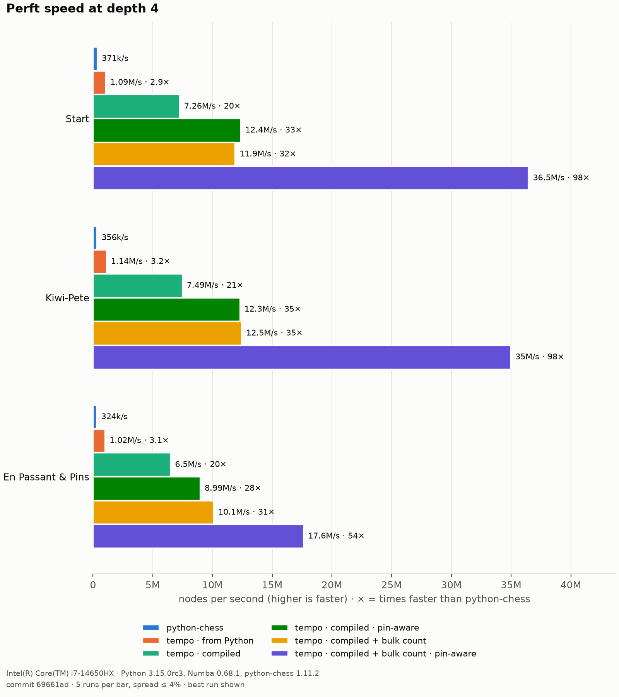
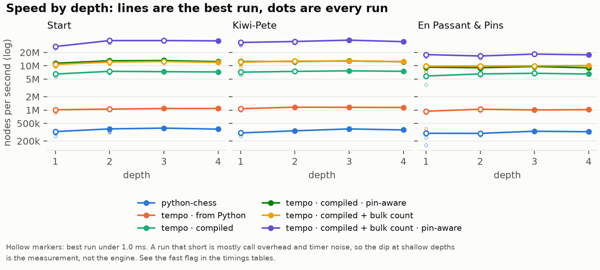
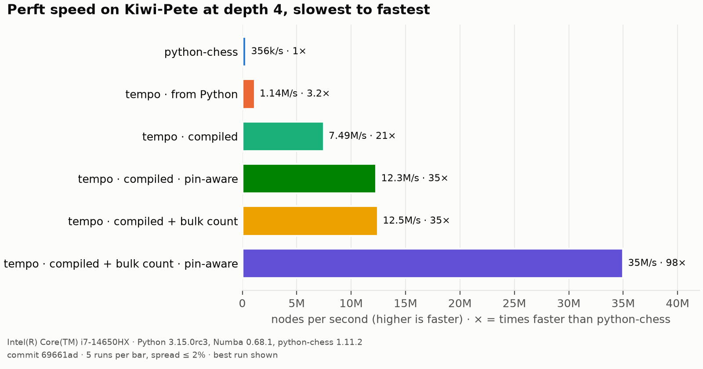

# Perft benchmark: `69661ad`, 2026-11-10

At depth 4, measured against python-chess on the same positions: **tempo · from Python** 2.9–3.2×, **tempo · compiled** 20–21×, **tempo · compiled · pin-aware** 28–35×, **tempo · compiled + bulk count** 31–35× and **tempo · compiled + bulk count · pin-aware** 54–98× (best run against best run; above 1× is faster).

| Position | Nodes | python-chess | tempo · from Python | tempo · compiled | tempo · compiled · pin-aware | tempo · compiled + bulk count | tempo · compiled + bulk count · pin-aware |
|---|---:|---:|---:|---:|---:|---:|---:|
| Start | 197,281 | 531.2 ms · 371.41k/s | 181.5 ms · 1.09M/s (2.9×) | 27.2 ms · 7.26M/s (20×) | 15.9 ms · 12.39M/s (33×) | 16.6 ms · 11.91M/s (32×) | 5.4 ms · 36.46M/s (98×) |
| Kiwi-Pete | 4,085,603 | 11.47 s · 356.33k/s | 3.57 s · 1.14M/s (3.2×) | 545.7 ms · 7.49M/s (21×) | 331.9 ms · 12.31M/s (35×) | 327.9 ms · 12.46M/s (35×) | 116.8 ms · 34.99M/s (98×) |
| En Passant & Pins | 43,238 | 133.3 ms · 324.47k/s | 42.3 ms · 1.02M/s (3.1×) | 6.6 ms · 6.50M/s (20×) | 4.8 ms · 8.99M/s (28×) | 4.3 ms · 10.12M/s (31×) | 2.5 ms · 17.64M/s (54×) |

## Correctness

Node counts from every run, checked against the published perft results on the [Chess Programming Wiki](https://www.chessprogramming.org/Perft_Results), which are independent of python-chess. A ✓ needs all runs of that engine to agree with it.

| Position | Depth | Published | python-chess | tempo · from Python | tempo · compiled | tempo · compiled · pin-aware | tempo · compiled + bulk count | tempo · compiled + bulk count · pin-aware |
|---|---:|---:|---:|---:|---:|---:|---:|---:|
| Start | 1 | 20 | 20 ✓ | 20 ✓ | 20 ✓ | 20 ✓ | 20 ✓ | 20 ✓ |
| Start | 2 | 400 | 400 ✓ | 400 ✓ | 400 ✓ | 400 ✓ | 400 ✓ | 400 ✓ |
| Start | 3 | 8,902 | 8,902 ✓ | 8,902 ✓ | 8,902 ✓ | 8,902 ✓ | 8,902 ✓ | 8,902 ✓ |
| Start | 4 | 197,281 | 197,281 ✓ | 197,281 ✓ | 197,281 ✓ | 197,281 ✓ | 197,281 ✓ | 197,281 ✓ |
| Kiwi-Pete | 1 | 48 | 48 ✓ | 48 ✓ | 48 ✓ | 48 ✓ | 48 ✓ | 48 ✓ |
| Kiwi-Pete | 2 | 2,039 | 2,039 ✓ | 2,039 ✓ | 2,039 ✓ | 2,039 ✓ | 2,039 ✓ | 2,039 ✓ |
| Kiwi-Pete | 3 | 97,862 | 97,862 ✓ | 97,862 ✓ | 97,862 ✓ | 97,862 ✓ | 97,862 ✓ | 97,862 ✓ |
| Kiwi-Pete | 4 | 4,085,603 | 4,085,603 ✓ | 4,085,603 ✓ | 4,085,603 ✓ | 4,085,603 ✓ | 4,085,603 ✓ | 4,085,603 ✓ |
| En Passant & Pins | 1 | 14 | 14 ✓ | 14 ✓ | 14 ✓ | 14 ✓ | 14 ✓ | 14 ✓ |
| En Passant & Pins | 2 | 191 | 191 ✓ | 191 ✓ | 191 ✓ | 191 ✓ | 191 ✓ | 191 ✓ |
| En Passant & Pins | 3 | 2,812 | 2,812 ✓ | 2,812 ✓ | 2,812 ✓ | 2,812 ✓ | 2,812 ✓ | 2,812 ✓ |
| En Passant & Pins | 4 | 43,238 | 43,238 ✓ | 43,238 ✓ | 43,238 ✓ | 43,238 ✓ | 43,238 ✓ | 43,238 ✓ |

Every run of every engine matches the published count.

## Engines
- **python-chess**: The course harness's reference_perft: chess.Board driven from Python, one push/pop per node, every leaf played.
- **tempo · from Python**: The course harness's custom_perft on b.Board, also driven from Python once per node with every leaf played. Mostly measures per-node interface cost, not move generation. Legality: copy-make.
- **tempo · compiled**: movegen.perft_every_leaf: the whole recursion in Numba, no Python per node, every leaf move made. What the board itself can do, on the same terms as the two above. Legality: copy-make.
- **tempo · compiled · pin-aware**: Same as tempo · compiled, with pin-aware legality: moves by unpinned non-king pieces skip the make-and-test check when not in check. Legality: pin-aware.
- **tempo · compiled + bulk count**: movegen.perft: like tempo · compiled, but the last ply is counted from the legal-move list instead of making each leaf move (bulk counting). Same nodes, less work per node. Legality: copy-make.
- **tempo · compiled + bulk count · pin-aware**: Same as tempo · compiled + bulk count, with pin-aware legality. Legality: pin-aware.

## All timings

Best, median and slowest of 5 runs per cell. Spread is (slowest − best) / best. Nodes/s and speedup use the best run. Flags: **fast** = best run under 1.0 ms, so call overhead and timer noise dominate; **noisy** = spread above 10%. Raw run times are under each table and in [results.json](results.json).

### Start

`rnbqkbnr/pppppppp/8/8/8/8/PPPPPPPP/RNBQKBNR w KQkq - 0 1`

| Depth | Nodes | Engine | Best | Median | Slowest | Spread | Nodes/s | vs python-chess | Flags |
|---:|---:|---|---:|---:|---:|---:|---:|---:|---|
| 1 | 20 | python-chess | 61 µs | 67 µs | 78 µs | 27% | 326.90k/s | — | fast, noisy |
| 1 | 20 | tempo · from Python | 20 µs | 21 µs | 23 µs | 18% | 1.01M/s | 3.1× | fast, noisy |
| 1 | 20 | tempo · compiled | 3 µs | 3 µs | 4 µs | 16% | 6.50M/s | 20× | fast, noisy |
| 1 | 20 | tempo · compiled · pin-aware | 2 µs | 2 µs | 2 µs | 10% | 11.39M/s | 35× | fast, noisy |
| 1 | 20 | tempo · compiled + bulk count | 2 µs | 2 µs | 2 µs | 15% | 10.70M/s | 33× | fast, noisy |
| 1 | 20 | tempo · compiled + bulk count · pin-aware | 1 µs | 1 µs | 1 µs | 11% | 27.17M/s | 83× | fast, noisy |
| 2 | 400 | python-chess | 1.1 ms | 1.1 ms | 1.3 ms | 19% | 375.98k/s | — | noisy |
| 2 | 400 | tempo · from Python | 380 µs | 387 µs | 395 µs | 4% | 1.05M/s | 2.8× | fast |
| 2 | 400 | tempo · compiled | 53 µs | 58 µs | 59 µs | 10% | 7.48M/s | 20× | fast, noisy |
| 2 | 400 | tempo · compiled · pin-aware | 31 µs | 33 µs | 34 µs | 11% | 12.96M/s | 34× | fast, noisy |
| 2 | 400 | tempo · compiled + bulk count | 33 µs | 36 µs | 36 µs | 11% | 12.15M/s | 32× | fast, noisy |
| 2 | 400 | tempo · compiled + bulk count · pin-aware | 11 µs | 12 µs | 12 µs | 13% | 37.08M/s | 99× | fast, noisy |
| 3 | 8,902 | python-chess | 22.7 ms | 22.8 ms | 23.0 ms | 1% | 391.54k/s | — |  |
| 3 | 8,902 | tempo · from Python | 8.2 ms | 8.3 ms | 8.4 ms | 2% | 1.08M/s | 2.8× |  |
| 3 | 8,902 | tempo · compiled | 1.2 ms | 1.2 ms | 1.2 ms | 2% | 7.35M/s | 19× |  |
| 3 | 8,902 | tempo · compiled · pin-aware | 678 µs | 703 µs | 737 µs | 9% | 13.12M/s | 34× | fast |
| 3 | 8,902 | tempo · compiled + bulk count | 711 µs | 754 µs | 781 µs | 10% | 12.51M/s | 32× | fast |
| 3 | 8,902 | tempo · compiled + bulk count · pin-aware | 240 µs | 255 µs | 256 µs | 7% | 37.07M/s | 95× | fast |
| 4 | 197,281 | python-chess | 531.2 ms | 535.4 ms | 537.2 ms | 1% | 371.41k/s | — |  |
| 4 | 197,281 | tempo · from Python | 181.5 ms | 183.0 ms | 183.3 ms | 1% | 1.09M/s | 2.9× |  |
| 4 | 197,281 | tempo · compiled | 27.2 ms | 27.2 ms | 27.6 ms | 1% | 7.26M/s | 20× |  |
| 4 | 197,281 | tempo · compiled · pin-aware | 15.9 ms | 16.0 ms | 16.1 ms | 1% | 12.39M/s | 33× |  |
| 4 | 197,281 | tempo · compiled + bulk count | 16.6 ms | 16.7 ms | 16.7 ms | 1% | 11.91M/s | 32× |  |
| 4 | 197,281 | tempo · compiled + bulk count · pin-aware | 5.4 ms | 5.5 ms | 5.6 ms | 3% | 36.46M/s | 98× |  |

Raw run times, in run order

| Depth | Engine | Runs (ms) |
|---:|---|---|
| 1 | python-chess | 0.07778, 0.06599, 0.06118, 0.06665, 0.06801 |
| 1 | tempo · from Python | 0.02336, 0.01972, 0.02045, 0.0212, 0.02153 |
| 1 | tempo · compiled | 0.003581, 0.003076, 0.003241, 0.003325, 0.003261 |
| 1 | tempo · compiled · pin-aware | 0.001935, 0.001756, 0.001884, 0.001844, 0.00185 |
| 1 | tempo · compiled + bulk count | 0.002148, 0.001869, 0.00207, 0.001974, 0.002019 |
| 1 | tempo · compiled + bulk count · pin-aware | 0.000784, 0.000736, 0.000814, 0.000769, 0.000765 |
| 2 | python-chess | 1.269, 1.115, 1.088, 1.139, 1.064 |
| 2 | tempo · from Python | 0.3849, 0.3951, 0.3796, 0.387, 0.3922 |
| 2 | tempo · compiled | 0.0539, 0.05787, 0.05883, 0.05345, 0.05888 |
| 2 | tempo · compiled · pin-aware | 0.03087, 0.03349, 0.03404, 0.0309, 0.03417 |
| 2 | tempo · compiled + bulk count | 0.03308, 0.03562, 0.03635, 0.03291, 0.03644 |
| 2 | tempo · compiled + bulk count · pin-aware | 0.01083, 0.01166, 0.01219, 0.01079, 0.01203 |
| 3 | python-chess | 22.96, 22.76, 22.74, 22.84, 22.78 |
| 3 | tempo · from Python | 8.289, 8.354, 8.206, 8.314, 8.304 |
| 3 | tempo · compiled | 1.24, 1.219, 1.219, 1.21, 1.235 |
| 3 | tempo · compiled · pin-aware | 0.6784, 0.7028, 0.7236, 0.701, 0.7373 |
| 3 | tempo · compiled + bulk count | 0.7115, 0.7142, 0.7809, 0.756, 0.754 |
| 3 | tempo · compiled + bulk count · pin-aware | 0.2401, 0.2543, 0.2548, 0.2548, 0.2563 |
| 4 | python-chess | 537.2, 536.8, 532.4, 535.4, 531.2 |
| 4 | tempo · from Python | 183, 183.1, 183.3, 181.5, 181.7 |
| 4 | tempo · compiled | 27.2, 27.57, 27.42, 27.17, 27.24 |
| 4 | tempo · compiled · pin-aware | 16, 16.07, 16.1, 15.93, 16 |
| 4 | tempo · compiled + bulk count | 16.65, 16.72, 16.71, 16.73, 16.57 |
| 4 | tempo · compiled + bulk count · pin-aware | 5.54, 5.45, 5.598, 5.528, 5.41 |

### Kiwi-Pete

`r3k2r/p1ppqpb1/bn2pnp1/3PN3/1p2P3/2N2Q1p/PPPBBPPP/R3K2R w KQkq - 0 1`

| Depth | Nodes | Engine | Best | Median | Slowest | Spread | Nodes/s | vs python-chess | Flags |
|---:|---:|---|---:|---:|---:|---:|---:|---:|---|
| 1 | 48 | python-chess | 157 µs | 161 µs | 187 µs | 19% | 305.04k/s | — | fast, noisy |
| 1 | 48 | tempo · from Python | 45 µs | 46 µs | 50 µs | 11% | 1.08M/s | 3.5× | fast, noisy |
| 1 | 48 | tempo · compiled | 7 µs | 7 µs | 8 µs | 15% | 7.18M/s | 24× | fast, noisy |
| 1 | 48 | tempo · compiled · pin-aware | 4 µs | 4 µs | 4 µs | 12% | 12.45M/s | 41× | fast, noisy |
| 1 | 48 | tempo · compiled + bulk count | 4 µs | 4 µs | 5 µs | 33% | 12.13M/s | 40× | fast, noisy |
| 1 | 48 | tempo · compiled + bulk count · pin-aware | 1 µs | 2 µs | 2 µs | 16% | 33.57M/s | 110× | fast, noisy |
| 2 | 2,039 | python-chess | 6.0 ms | 6.1 ms | 6.2 ms | 3% | 340.36k/s | — |  |
| 2 | 2,039 | tempo · from Python | 1.8 ms | 1.8 ms | 1.8 ms | 2% | 1.16M/s | 3.4× |  |
| 2 | 2,039 | tempo · compiled | 273 µs | 283 µs | 284 µs | 4% | 7.46M/s | 22× | fast |
| 2 | 2,039 | tempo · compiled · pin-aware | 163 µs | 172 µs | 177 µs | 9% | 12.52M/s | 37× | fast |
| 2 | 2,039 | tempo · compiled + bulk count | 160 µs | 161 µs | 175 µs | 9% | 12.71M/s | 37× | fast |
| 2 | 2,039 | tempo · compiled + bulk count · pin-aware | 58 µs | 58 µs | 63 µs | 9% | 35.29M/s | 104× | fast |
| 3 | 97,862 | python-chess | 260.5 ms | 261.1 ms | 262.4 ms | 1% | 375.63k/s | — |  |
| 3 | 97,862 | tempo · from Python | 84.9 ms | 85.7 ms | 86.4 ms | 2% | 1.15M/s | 3.1× |  |
| 3 | 97,862 | tempo · compiled | 12.7 ms | 12.9 ms | 13.3 ms | 4% | 7.69M/s | 20× |  |
| 3 | 97,862 | tempo · compiled · pin-aware | 7.6 ms | 7.7 ms | 8.0 ms | 6% | 12.87M/s | 34× |  |
| 3 | 97,862 | tempo · compiled + bulk count | 7.7 ms | 7.7 ms | 8.0 ms | 4% | 12.77M/s | 34× |  |
| 3 | 97,862 | tempo · compiled + bulk count · pin-aware | 2.6 ms | 2.6 ms | 2.7 ms | 6% | 37.87M/s | 101× |  |
| 4 | 4,085,603 | python-chess | 11.47 s | 11.52 s | 11.53 s | 1% | 356.33k/s | — |  |
| 4 | 4,085,603 | tempo · from Python | 3.57 s | 3.58 s | 3.59 s | 1% | 1.14M/s | 3.2× |  |
| 4 | 4,085,603 | tempo · compiled | 545.7 ms | 546.9 ms | 552.6 ms | 1% | 7.49M/s | 21× |  |
| 4 | 4,085,603 | tempo · compiled · pin-aware | 331.9 ms | 334.5 ms | 336.9 ms | 2% | 12.31M/s | 35× |  |
| 4 | 4,085,603 | tempo · compiled + bulk count | 327.9 ms | 330.9 ms | 333.7 ms | 2% | 12.46M/s | 35× |  |
| 4 | 4,085,603 | tempo · compiled + bulk count · pin-aware | 116.8 ms | 117.3 ms | 118.8 ms | 2% | 34.99M/s | 98× |  |

Raw run times, in run order

| Depth | Engine | Runs (ms) |
|---:|---|---|
| 1 | python-chess | 0.1875, 0.1692, 0.1574, 0.1614, 0.1603 |
| 1 | tempo · from Python | 0.04968, 0.04682, 0.04463, 0.04565, 0.04557 |
| 1 | tempo · compiled | 0.007714, 0.007175, 0.006684, 0.007043, 0.00711 |
| 1 | tempo · compiled · pin-aware | 0.0043, 0.004202, 0.003856, 0.004145, 0.004232 |
| 1 | tempo · compiled + bulk count | 0.004631, 0.005256, 0.003956, 0.004136, 0.004295 |
| 1 | tempo · compiled + bulk count · pin-aware | 0.00166, 0.001455, 0.00143, 0.001598, 0.001584 |
| 2 | python-chess | 6.145, 5.991, 6.051, 6.049, 6.19 |
| 2 | tempo · from Python | 1.765, 1.763, 1.772, 1.789, 1.756 |
| 2 | tempo · compiled | 0.2832, 0.2732, 0.277, 0.2841, 0.2842 |
| 2 | tempo · compiled · pin-aware | 0.1769, 0.169, 0.1719, 0.1726, 0.1629 |
| 2 | tempo · compiled + bulk count | 0.1604, 0.1718, 0.1604, 0.1751, 0.1611 |
| 2 | tempo · compiled + bulk count · pin-aware | 0.05786, 0.06273, 0.05795, 0.06269, 0.05778 |
| 3 | python-chess | 260.5, 261.1, 262.4, 261.1, 261.1 |
| 3 | tempo · from Python | 86.12, 86.44, 85.65, 85.58, 84.92 |
| 3 | tempo · compiled | 12.95, 13.3, 12.73, 12.88, 12.79 |
| 3 | tempo · compiled · pin-aware | 7.738, 8.043, 7.728, 7.722, 7.606 |
| 3 | tempo · compiled + bulk count | 7.751, 7.977, 7.723, 7.715, 7.662 |
| 3 | tempo · compiled + bulk count · pin-aware | 2.677, 2.746, 2.584, 2.619, 2.638 |
| 4 | python-chess | 1.153e+04, 1.147e+04, 1.152e+04, 1.151e+04, 1.153e+04 |
| 4 | tempo · from Python | 3586, 3572, 3579, 3572, 3594 |
| 4 | tempo · compiled | 548.9, 546.1, 546.9, 545.7, 552.6 |
| 4 | tempo · compiled · pin-aware | 334.2, 334.5, 335.6, 331.9, 336.9 |
| 4 | tempo · compiled + bulk count | 330.9, 329.3, 331.5, 327.9, 333.7 |
| 4 | tempo · compiled + bulk count · pin-aware | 117.7, 117.3, 116.8, 117, 118.8 |

### En Passant & Pins

`8/2p5/3p4/KP5r/1R3p1k/8/4P1P1/8 w - - 0 1`

| Depth | Nodes | Engine | Best | Median | Slowest | Spread | Nodes/s | vs python-chess | Flags |
|---:|---:|---|---:|---:|---:|---:|---:|---:|---|
| 1 | 14 | python-chess | 47 µs | 50 µs | 86 µs | 84% | 299.09k/s | — | fast, noisy |
| 1 | 14 | tempo · from Python | 15 µs | 15 µs | 37 µs | 149% | 939.79k/s | 3.1× | fast, noisy |
| 1 | 14 | tempo · compiled | 2 µs | 2 µs | 4 µs | 58% | 5.86M/s | 20× | fast, noisy |
| 1 | 14 | tempo · compiled · pin-aware | 2 µs | 2 µs | 2 µs | 29% | 9.30M/s | 31× | fast, noisy |
| 1 | 14 | tempo · compiled + bulk count | 1 µs | 2 µs | 2 µs | 32% | 9.79M/s | 33× | fast, noisy |
| 1 | 14 | tempo · compiled + bulk count · pin-aware | 1 µs | 1 µs | 1 µs | 14% | 17.88M/s | 60× | fast, noisy |
| 2 | 191 | python-chess | 641 µs | 673 µs | 709 µs | 11% | 297.97k/s | — | fast, noisy |
| 2 | 191 | tempo · from Python | 183 µs | 185 µs | 205 µs | 12% | 1.05M/s | 3.5× | fast, noisy |
| 2 | 191 | tempo · compiled | 29 µs | 29 µs | 33 µs | 12% | 6.55M/s | 22× | fast, noisy |
| 2 | 191 | tempo · compiled · pin-aware | 21 µs | 21 µs | 23 µs | 11% | 9.02M/s | 30× | fast, noisy |
| 2 | 191 | tempo · compiled + bulk count | 19 µs | 19 µs | 22 µs | 11% | 9.87M/s | 33× | fast, noisy |
| 2 | 191 | tempo · compiled + bulk count · pin-aware | 11 µs | 12 µs | 13 µs | 11% | 16.62M/s | 56× | fast, noisy |
| 3 | 2,812 | python-chess | 8.5 ms | 8.5 ms | 8.7 ms | 3% | 332.71k/s | — |  |
| 3 | 2,812 | tempo · from Python | 2.8 ms | 2.8 ms | 2.9 ms | 3% | 1.01M/s | 3.0× |  |
| 3 | 2,812 | tempo · compiled | 416 µs | 425 µs | 447 µs | 7% | 6.76M/s | 20× | fast |
| 3 | 2,812 | tempo · compiled · pin-aware | 292 µs | 308 µs | 330 µs | 13% | 9.63M/s | 29× | fast, noisy |
| 3 | 2,812 | tempo · compiled + bulk count | 282 µs | 285 µs | 286 µs | 2% | 9.97M/s | 30× | fast |
| 3 | 2,812 | tempo · compiled + bulk count · pin-aware | 153 µs | 155 µs | 158 µs | 3% | 18.36M/s | 55× | fast |
| 4 | 43,238 | python-chess | 133.3 ms | 134.0 ms | 134.7 ms | 1% | 324.47k/s | — |  |
| 4 | 43,238 | tempo · from Python | 42.3 ms | 42.5 ms | 42.9 ms | 1% | 1.02M/s | 3.1× |  |
| 4 | 43,238 | tempo · compiled | 6.6 ms | 6.7 ms | 6.8 ms | 2% | 6.50M/s | 20× |  |
| 4 | 43,238 | tempo · compiled · pin-aware | 4.8 ms | 4.8 ms | 4.9 ms | 1% | 8.99M/s | 28× |  |
| 4 | 43,238 | tempo · compiled + bulk count | 4.3 ms | 4.3 ms | 4.3 ms | 1% | 10.12M/s | 31× |  |
| 4 | 43,238 | tempo · compiled + bulk count · pin-aware | 2.5 ms | 2.5 ms | 2.5 ms | 3% | 17.64M/s | 54× |  |

Raw run times, in run order

| Depth | Engine | Runs (ms) |
|---:|---|---|
| 1 | python-chess | 0.08618, 0.05849, 0.04994, 0.04779, 0.04681 |
| 1 | tempo · from Python | 0.03706, 0.01667, 0.01493, 0.01513, 0.0149 |
| 1 | tempo · compiled | 0.003765, 0.002516, 0.00246, 0.002427, 0.002389 |
| 1 | tempo · compiled · pin-aware | 0.001944, 0.001541, 0.001505, 0.001543, 0.001645 |
| 1 | tempo · compiled + bulk count | 0.001887, 0.00143, 0.001537, 0.00153, 0.001514 |
| 1 | tempo · compiled + bulk count · pin-aware | 0.000892, 0.000805, 0.000807, 0.000784, 0.000783 |
| 2 | python-chess | 0.6727, 0.641, 0.6575, 0.6912, 0.709 |
| 2 | tempo · from Python | 0.1853, 0.1826, 0.1893, 0.205, 0.1828 |
| 2 | tempo · compiled | 0.02976, 0.02941, 0.02916, 0.03264, 0.02948 |
| 2 | tempo · compiled · pin-aware | 0.02149, 0.02117, 0.02145, 0.02347, 0.02132 |
| 2 | tempo · compiled + bulk count | 0.0194, 0.01935, 0.02141, 0.02156, 0.01937 |
| 2 | tempo · compiled + bulk count · pin-aware | 0.01154, 0.01174, 0.01272, 0.01275, 0.01149 |
| 3 | python-chess | 8.733, 8.452, 8.519, 8.534, 8.462 |
| 3 | tempo · from Python | 2.88, 2.868, 2.795, 2.837, 2.827 |
| 3 | tempo · compiled | 0.4329, 0.4255, 0.4159, 0.4465, 0.4222 |
| 3 | tempo · compiled · pin-aware | 0.311, 0.3296, 0.2921, 0.3078, 0.2925 |
| 3 | tempo · compiled + bulk count | 0.2819, 0.2865, 0.2826, 0.2862, 0.2849 |
| 3 | tempo · compiled + bulk count · pin-aware | 0.1532, 0.1551, 0.1556, 0.1575, 0.1552 |
| 4 | python-chess | 134.7, 134, 134, 133.3, 133.3 |
| 4 | tempo · from Python | 42.87, 42.85, 42.34, 42.33, 42.51 |
| 4 | tempo · compiled | 6.705, 6.765, 6.709, 6.689, 6.648 |
| 4 | tempo · compiled · pin-aware | 4.863, 4.811, 4.854, 4.815, 4.833 |
| 4 | tempo · compiled + bulk count | 4.301, 4.338, 4.329, 4.274, 4.274 |
| 4 | tempo · compiled + bulk count · pin-aware | 2.454, 2.491, 2.451, 2.497, 2.529 |

## Warm-up (not counted)

One run per engine and position at depth 2 before any measurement, recorded here and left out of every other number. For tempo the first one includes Numba compiling or loading its cache, which is why it is much slower than the rest.

| Position | python-chess | tempo · from Python | tempo · compiled | tempo · compiled · pin-aware | tempo · compiled + bulk count | tempo · compiled + bulk count · pin-aware |
|---|---:|---:|---:|---:|---:|---:|
| Start | 1.7 ms | 5.0 ms | 3.1 ms | 35 µs | 3.2 ms | 13 µs |
| Kiwi-Pete | 6.3 ms | 1.8 ms | 262 µs | 160 µs | 163 µs | 62 µs |
| En Passant & Pins | 705 µs | 194 µs | 32 µs | 23 µs | 21 µs | 13 µs |

## Run
- **Commit:** `69661ad`
- **When:** 2026-11-10T13:57:56 to 2026-11-10T13:59:25
- **Machine:** Intel(R) Core(TM) i7-14650HX, 24 threads, Linux-7.0.0-43-generic-x86_64-with-glibc2.43
- **Load average:** [2.17, 1.66, 1.34] at start, [2.06, 1.7, 1.38] at end (1, 5, 15 min)
- **Versions:** Python 3.15.0rc3, python-chess 1.11.2, numba 0.68.1, JIT on
- **Settings:** depths 1–4, 5 timed runs per engine per cell, warm-up at depth 2, GC off while timing, time.perf_counter (resolution 1e-09 s)

## Method
- Each engine's position object is built once per cell, outside the timer. Perft pushes and pops back to the root, so later runs start from the same position.
- Within a cell, engines take turns run by run (A, B, C, A, B, C, ...), so slow drift such as thermal throttling or background load hits every engine alike instead of one engine's whole batch.
- The garbage collector is off while timing, as in `timeit`.
- Best run is the headline number because noise only ever adds time; median and slowest are shown so you can see how much noise there was.
- Everything on this page is generated from `results.json` by `bench/report.py`; no number is typed by hand.

_Regenerate with `python -m ccc26.user.eradcliffe.bench.report 2026-11-10_135756_69661ad`._
