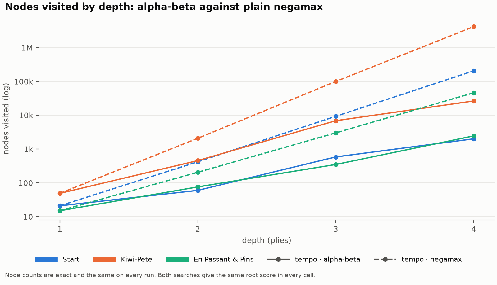
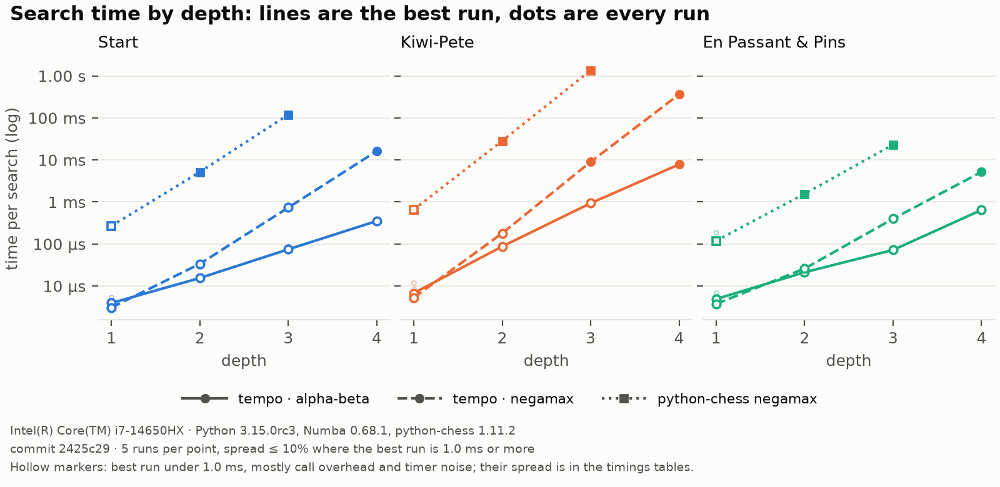
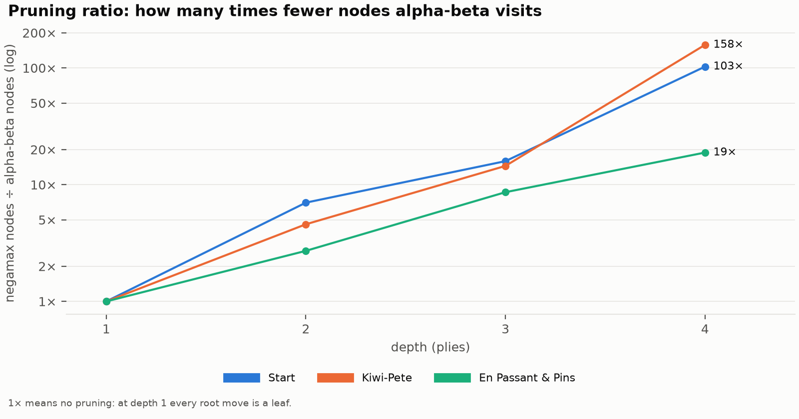

# Search benchmark: `2425c29`, 2026-11-24

At depth 4, alpha-beta visits 19–158× fewer nodes than plain negamax and is 8.1–46× faster, with the same root score. At depth 3, against the python-chess negamax: alpha-beta 321–1604× faster, negamax 58–163× (the same tree, so this is the compiled-vs-Python gap). Evaluation: 134.34M/s compiled, 6.08M/s called from Python once per position, 138.93k/s for the python-chess material count.

## Nodes and scores

Node counts, scores and moves are deterministic, so they are printed exactly (from the first run; every other run must match). Nodes include the root. The root score is in centipawns for the side to move; ✓ means every engine that searched that cell gave the same score.

| Position | Depth | alpha-beta nodes | negamax nodes | negamax ÷ alpha-beta | Root score | python-chess score | alpha-beta move | negamax move |
|---|---:|---:|---:|---:|---:|---:|---|---|
| Start | 1 | 21 | 21 | 1.0× | 0 ✓ | 0 | a2a3 | a2a3 |
| Start | 2 | 60 | 421 | 7.0× | 0 ✓ | 0 | a2a3 | a2a3 |
| Start | 3 | 586 | 9,323 | 15.9× | 0 ✓ | 0 | a2a3 | a2a3 |
| Start | 4 | 2,012 | 206,604 | 102.7× | 0 ✓ | — | a2a3 | a2a3 |
| Kiwi-Pete | 1 | 49 | 49 | 1.0× | 330 ✓ | 330 | e2a6 | e2a6 |
| Kiwi-Pete | 2 | 456 | 2,088 | 4.6× | 10 ✓ | 10 | e2a6 | e2a6 |
| Kiwi-Pete | 3 | 6,903 | 99,950 | 14.5× | 330 ✓ | 330 | e2a6 | e2a6 |
| Kiwi-Pete | 4 | 26,518 | 4,185,553 | 157.8× | 10 ✓ | — | e2a6 | e2a6 |
| En Passant & Pins | 1 | 15 | 15 | 1.0× | 100 ✓ | 100 | b4f4 | b4f4 |
| En Passant & Pins | 2 | 76 | 206 | 2.7× | 100 ✓ | 100 | b4f4 | b4f4 |
| En Passant & Pins | 3 | 350 | 3,018 | 8.6× | 100 ✓ | 100 | e2e3 | e2e3 |
| En Passant & Pins | 4 | 2,454 | 46,256 | 18.8× | 0 ✓ | — | e2e3 | e2e3 |

Every check passes: alpha-beta and negamax give the same root score in every cell, the python-chess negamax agrees wherever it ran, alpha-beta never visits more nodes, every engine repeats its own nodes, score and move on every run, and evaluate() matches the python-chess material count on every position.

## Evaluation speed

2,400 positions: every node of 20 seeded random games (seed 2026, up to 40 plies) from each position. Each timed run passes over the whole set `Passes` times, enough to last at least 20.0 ms, so even the compiled loop is well above timer noise; best and median of 5 runs. All three give the same score on every position.

| Way | Passes | Best | Median | Spread | Evals/s | vs python-chess | What |
|---|---:|---:|---:|---:|---:|---:|---|
| python-chess | 1 | 17.3 ms | 17.3 ms | 2% | 138.93k/s | — | material() from tests/test_evaluate.py: a python-chess piece_map() count, per position from Python. |
| tempo-call | 64 | 25.3 ms | 25.4 ms | 3% | 6.08M/s | 44× | Compiled evaluate(), called once per position from Python: includes the Python-to-Numba call, like Evaluator.evaluate. |
| tempo-loop | 2048 | 36.6 ms | 37.1 ms | 2% | 134.34M/s | 967× | Compiled evaluate() in a compiled loop over all positions: the eval itself. |

## Engines
All use the material eval and the leaf rules in `search.py`: no legal move is mate or stalemate, a leaf in check with no legal move is mate, otherwise the static eval.
- **tempo · alpha-beta** (depths 1–4): search.search_root with alpha-beta pruning (fail-soft, full window at the root). Compiled, one state array changed in place, pin-aware legality.
- **tempo · negamax** (depths 1–4): search.search_root with pruning off: every move searched. The compiled reference alpha-beta must match.
- **python-chess negamax** (depths 1–3): reference_negamax from tests/test_search.py: plain negamax on chess.Board from Python, same material eval and leaf rules. Returns the score only; it searches the same tree as tempo · negamax.

## All timings

Best, median and slowest of 5 runs per cell. Spread is (slowest − best) / best. Nodes/s uses the best run; python-chess doesn't count nodes, so its nodes/s uses negamax's count (it searches the same tree). Flags: **fast** = best run under 1.0 ms, so call overhead and timer noise dominate; **noisy** = spread above 10%. Raw run times are under each table and in [results.json](results.json).

### Start

`rnbqkbnr/pppppppp/8/8/8/8/PPPPPPPP/RNBQKBNR w KQkq - 0 1`

| Depth | Engine | Nodes | Best | Median | Slowest | Spread | Nodes/s | Score | Move | Flags |
|---:|---|---:|---:|---:|---:|---:|---:|---:|---|---|
| 1 | tempo · alpha-beta | 21 | 4 µs | 5 µs | 5 µs | 36% | 5.34M/s | 0 | a2a3 | fast, noisy |
| 1 | tempo · negamax | 21 | 3 µs | 3 µs | 3 µs | 14% | 6.84M/s | 0 | a2a3 | fast, noisy |
| 1 | python-chess negamax | — | 268 µs | 277 µs | 298 µs | 11% | 78.35k/s | 0 | — | fast, noisy |
| 2 | tempo · alpha-beta | 60 | 15 µs | 16 µs | 17 µs | 7% | 27.19M/s | 0 | a2a3 | fast |
| 2 | tempo · negamax | 421 | 34 µs | 34 µs | 37 µs | 10% | 12.52M/s | 0 | a2a3 | fast, noisy |
| 2 | python-chess negamax | — | 5.2 ms | 5.2 ms | 5.3 ms | 2% | 81.58k/s | 0 | — |  |
| 3 | tempo · alpha-beta | 586 | 75 µs | 82 µs | 87 µs | 17% | 124.97M/s | 0 | a2a3 | fast, noisy |
| 3 | tempo · negamax | 9,323 | 735 µs | 752 µs | 764 µs | 4% | 12.69M/s | 0 | a2a3 | fast |
| 3 | python-chess negamax | — | 119.6 ms | 121.1 ms | 131.0 ms | 10% | 77.92k/s | 0 | — |  |
| 4 | tempo · alpha-beta | 2,012 | 352 µs | 361 µs | 385 µs | 9% | 586.52M/s | 0 | a2a3 | fast |
| 4 | tempo · negamax | 206,604 | 16.3 ms | 16.5 ms | 16.7 ms | 2% | 12.70M/s | 0 | a2a3 |  |

Raw run times, in run order

| Depth | Engine | Runs (ms) |
|---:|---|---|
| 1 | tempo · alpha-beta | 0.005346, 0.004507, 0.00459, 0.003989, 0.003935 |
| 1 | tempo · negamax | 0.003492, 0.003364, 0.003396, 0.003072, 0.003145 |
| 1 | python-chess negamax | 0.298, 0.2825, 0.2775, 0.2739, 0.268 |
| 2 | tempo · alpha-beta | 0.01548, 0.01567, 0.01661, 0.01596, 0.01594 |
| 2 | tempo · negamax | 0.03385, 0.03363, 0.03706, 0.03415, 0.03419 |
| 2 | python-chess negamax | 5.161, 5.181, 5.206, 5.252, 5.277 |
| 3 | tempo · alpha-beta | 0.08721, 0.08201, 0.0746, 0.08575, 0.07936 |
| 3 | tempo · negamax | 0.7392, 0.7614, 0.7517, 0.7639, 0.7349 |
| 3 | python-chess negamax | 121.1, 121.6, 131, 119.6, 119.9 |
| 4 | tempo · alpha-beta | 0.3697, 0.3523, 0.361, 0.3598, 0.3855 |
| 4 | tempo · negamax | 16.37, 16.27, 16.51, 16.66, 16.66 |

### Kiwi-Pete

`r3k2r/p1ppqpb1/bn2pnp1/3PN3/1p2P3/2N2Q1p/PPPBBPPP/R3K2R w KQkq - 0 1`

| Depth | Engine | Nodes | Best | Median | Slowest | Spread | Nodes/s | Score | Move | Flags |
|---:|---|---:|---:|---:|---:|---:|---:|---:|---|---|
| 1 | tempo · alpha-beta | 49 | 7 µs | 7 µs | 12 µs | 73% | 7.25M/s | 330 | e2a6 | fast, noisy |
| 1 | tempo · negamax | 49 | 5 µs | 6 µs | 6 µs | 14% | 9.27M/s | 330 | e2a6 | fast, noisy |
| 1 | python-chess negamax | — | 658 µs | 697 µs | 738 µs | 12% | 74.47k/s | 330 | — | fast, noisy |
| 2 | tempo · alpha-beta | 456 | 87 µs | 91 µs | 96 µs | 10% | 23.90M/s | 10 | e2a6 | fast |
| 2 | tempo · negamax | 2,088 | 180 µs | 186 µs | 190 µs | 5% | 11.60M/s | 10 | e2a6 | fast |
| 2 | python-chess negamax | — | 28.5 ms | 28.7 ms | 29.1 ms | 2% | 73.26k/s | 10 | — |  |
| 3 | tempo · alpha-beta | 6,903 | 935 µs | 966 µs | 1.0 ms | 9% | 106.85M/s | 330 | e2a6 | fast |
| 3 | tempo · negamax | 99,950 | 9.0 ms | 9.1 ms | 9.2 ms | 3% | 11.09M/s | 330 | e2a6 |  |
| 3 | python-chess negamax | — | 1.36 s | 1.37 s | 1.38 s | 2% | 73.63k/s | 330 | — |  |
| 4 | tempo · alpha-beta | 26,518 | 7.8 ms | 7.9 ms | 8.0 ms | 2% | 533.61M/s | 10 | e2a6 |  |
| 4 | tempo · negamax | 4,185,553 | 364.7 ms | 367.7 ms | 368.9 ms | 1% | 11.48M/s | 10 | e2a6 |  |

Raw run times, in run order

| Depth | Engine | Runs (ms) |
|---:|---|---|
| 1 | tempo · alpha-beta | 0.0117, 0.00731, 0.006762, 0.008557, 0.007302 |
| 1 | tempo · negamax | 0.006025, 0.005538, 0.005284, 0.005876, 0.005893 |
| 1 | python-chess negamax | 0.7378, 0.658, 0.6971, 0.706, 0.6889 |
| 2 | tempo · alpha-beta | 0.08736, 0.0906, 0.09086, 0.09379, 0.0959 |
| 2 | tempo · negamax | 0.186, 0.1849, 0.1858, 0.18, 0.1896 |
| 2 | python-chess negamax | 29.11, 28.76, 28.68, 28.69, 28.5 |
| 3 | tempo · alpha-beta | 0.948, 0.9781, 0.9354, 1.018, 0.966 |
| 3 | tempo · negamax | 9.122, 9.169, 9.011, 9.25, 9.109 |
| 3 | python-chess negamax | 1385, 1366, 1358, 1365, 1367 |
| 4 | tempo · alpha-beta | 7.93, 7.905, 7.844, 7.994, 7.888 |
| 4 | tempo · negamax | 365.9, 367.7, 368.8, 368.9, 364.7 |

### En Passant & Pins

`8/2p5/3p4/KP5r/1R3p1k/8/4P1P1/8 w - - 0 1`

| Depth | Engine | Nodes | Best | Median | Slowest | Spread | Nodes/s | Score | Move | Flags |
|---:|---|---:|---:|---:|---:|---:|---:|---:|---|---|
| 1 | tempo · alpha-beta | 15 | 5 µs | 5 µs | 7 µs | 42% | 3.06M/s | 100 | b4f4 | fast, noisy |
| 1 | tempo · negamax | 15 | 4 µs | 4 µs | 4 µs | 7% | 4.01M/s | 100 | b4f4 | fast |
| 1 | python-chess negamax | — | 119 µs | 131 µs | 185 µs | 55% | 125.55k/s | 100 | — | fast, noisy |
| 2 | tempo · alpha-beta | 76 | 21 µs | 23 µs | 25 µs | 16% | 9.71M/s | 100 | b4f4 | fast, noisy |
| 2 | tempo · negamax | 206 | 26 µs | 26 µs | 27 µs | 3% | 7.93M/s | 100 | b4f4 | fast |
| 2 | python-chess negamax | — | 1.6 ms | 1.6 ms | 1.6 ms | 3% | 132.23k/s | 100 | — |  |
| 3 | tempo · alpha-beta | 350 | 72 µs | 79 µs | 83 µs | 15% | 41.88M/s | 100 | e2e3 | fast, noisy |
| 3 | tempo · negamax | 3,018 | 398 µs | 399 µs | 424 µs | 6% | 7.59M/s | 100 | e2e3 | fast |
| 3 | python-chess negamax | — | 23.1 ms | 23.7 ms | 24.1 ms | 4% | 130.62k/s | 100 | — |  |
| 4 | tempo · alpha-beta | 2,454 | 645 µs | 652 µs | 703 µs | 9% | 71.68M/s | 0 | e2e3 | fast |
| 4 | tempo · negamax | 46,256 | 5.2 ms | 5.3 ms | 5.3 ms | 3% | 8.89M/s | 0 | e2e3 |  |

Raw run times, in run order

| Depth | Engine | Runs (ms) |
|---:|---|---|
| 1 | tempo · alpha-beta | 0.006966, 0.005885, 0.004983, 0.004913, 0.004897 |
| 1 | tempo · negamax | 0.004016, 0.00394, 0.003744, 0.003812, 0.003989 |
| 1 | python-chess negamax | 0.1853, 0.1361, 0.1307, 0.1213, 0.1195 |
| 2 | tempo · alpha-beta | 0.02213, 0.02469, 0.02295, 0.02122, 0.02257 |
| 2 | tempo · negamax | 0.02597, 0.0261, 0.02687, 0.02633, 0.02605 |
| 2 | python-chess negamax | 1.572, 1.558, 1.601, 1.558, 1.56 |
| 3 | tempo · alpha-beta | 0.07206, 0.08289, 0.07862, 0.07806, 0.07984 |
| 3 | tempo · negamax | 0.3979, 0.4146, 0.3993, 0.3978, 0.4236 |
| 3 | python-chess negamax | 23.1, 23.7, 23.67, 23.77, 24.1 |
| 4 | tempo · alpha-beta | 0.6706, 0.7031, 0.6519, 0.6453, 0.6522 |
| 4 | tempo · negamax | 5.347, 5.292, 5.244, 5.293, 5.201 |

## Warm-up (not counted)

One run per engine and position before any measurement, left out of every other number. For tempo the first one includes Numba compiling or loading its cache.

| Position | Engine | Depth | Time |
|---|---|---:|---:|
| Start | tempo · alpha-beta | 2 | 4.9 ms |
| Start | tempo · negamax | 2 | 40 µs |
| Start | python-chess negamax | 2 | 5.8 ms |
| Kiwi-Pete | tempo · alpha-beta | 2 | 90 µs |
| Kiwi-Pete | tempo · negamax | 2 | 180 µs |
| Kiwi-Pete | python-chess negamax | 2 | 28.9 ms |
| En Passant & Pins | tempo · alpha-beta | 2 | 26 µs |
| En Passant & Pins | tempo · negamax | 2 | 28 µs |
| En Passant & Pins | python-chess negamax | 2 | 1.6 ms |

## Run
- **Commit:** `2425c29`
- **When:** 2026-11-24T12:08:49 to 2026-11-24T12:09:00
- **Machine:** Intel(R) Core(TM) i7-14650HX, 24 threads, Linux-7.0.0-44-generic-x86_64-with-glibc2.43
- **Load average:** [0.73, 0.81, 0.81] at start, [0.78, 0.82, 0.81] at end (1, 5, 15 min)
- **Versions:** Python 3.15.0rc3, python-chess 1.11.2, numba 0.68.1, JIT on
- **Settings:** depths 1–4, 5 timed runs per engine per cell, python-chess to depth 3, warm-up at depth 2, GC off while timing, time.perf_counter (resolution 1e-09 s)

## Method
- Each engine's position object is built once per cell, outside the timer. The searches restore it, so later runs start from the same position.
- Within a cell, engines take turns run by run, so slow drift hits every engine alike.
- The garbage collector is off while timing, as in `timeit`.
- Best run is the headline number because noise only ever adds time.
- Everything on this page is generated from `results.json` by `bench/search/report.py`.

_Regenerate with `python -m ccc26.user.eradcliffe.bench.search.report 2026-11-24_120849_2425c29_search`._
